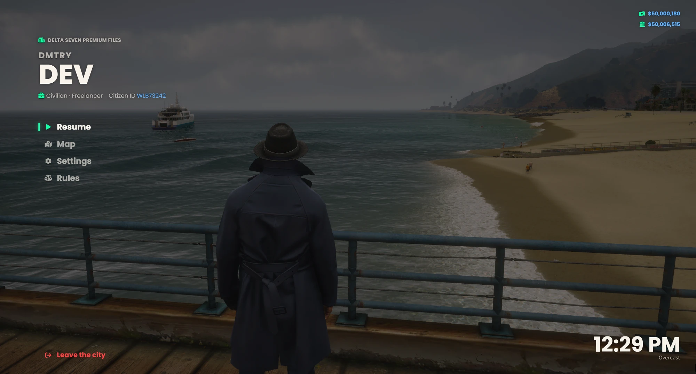

<p align="center"></p>
<h1 align="center">Pause Menu</h1>
<p align="center"><b>Free FiveM pause menu for QBCore, QBox & ESX</b></p>
<p align="center"><a href="#english">English</a> · <a href="#arabic">العربية</a></p>

<p align="center"></p>

<a id="english"></a>

## Pause Menu: free FiveM pause menu for QBCore, QBox & ESX

A clean pause menu that opens with ESC or P. It shows the player's character, job, money, the game time and the weather, and gives them Map, Settings, Rules and Leave in one place.

[Download](https://github.com/d7teamdev/fivem-pause-menu/releases/latest) · [Website](https://d7team.com) · [Discord](https://discord.gg/d-7)

### At a glance

| | |
|---|---|
| **Price** | Free |
| **Works with** | QBCore, QBox and ESX |
| **Opens with** | ESC or P |
| **Language** | English |
| **Database** | None |

### Features

- The server's name, the character's name, job and grade, gang and citizen ID (ESX has no citizen ID or gang).
- Cash and bank in the top corner.
- The game time and the weather.
- **Resume**, **Map** and **Settings** open the game's own pages.
- **Rules**: your server's rules, written in the config.
- **Leave the city**: asks first, then disconnects the player with your own message.
- The game's HUD and minimap are hidden while the menu is open.
- Colours from the config.
- A Discord log when a player leaves from the menu.
- Exports for your own scripts: `IsOpen()`, `Close()` and `Block(true / false)`.

### Requirements

- A QBCore, QBox or ESX server.

### Installation

1. Download `d7-pausemenu-1.0.0.zip` from [Releases](https://github.com/d7teamdev/fivem-pause-menu/releases/latest).
2. Put the `d7-pausemenu` folder in your `resources` folder. Keep the folder name `d7-pausemenu`: under any other name it does not start.
3. In `server.cfg`, start it after your framework:

   ```cfg
   ensure d7-pausemenu
   ```

4. Edit `config/config.lua` (server name, rules, leave message, colours, Discord webhooks).
5. Restart the server.

### Configuration

`config/config.lua` and `locales.lua` are open. The rest of the code is protected.

| Setting | What it does |
|---|---|
| `Config.ServerName` | The name over the menu. Empty: your server's own name (`sv_projectName`). |
| `Config.Rules` | The lines of the Rules page. Empty: no Rules button. |
| `Config.ExitMessage` | What a player reads when they leave from the menu. |
| `Config.Colors` | `Primary` for the icons and the chosen line, `Secondary` for the citizen ID. |
| `Config.Webhooks` | Discord webhook links: `leave`, or `default` for all. Empty: no log. |

### For developers

```lua
exports['d7-pausemenu']:IsOpen()       -- true while the menu is open
exports['d7-pausemenu']:Close()        -- closes it (a phone call, a cutscene, a teleport)
exports['d7-pausemenu']:Block(true)    -- your page reads ESC itself: the menu does not open
exports['d7-pausemenu']:Block(false)   -- the menu opens again
```

On the client, `d7-pause:open` fires with `true` when the menu opens and `false` when it closes.

### Support

Support is on our Discord: [discord.gg/d-7](https://discord.gg/d-7). Issues are closed on this repository so no request waits unread.

### More from Delta Seven

- [Delta Panel](https://github.com/d7teamdev/delta-panel): FiveM Admin Panel for QBCore, QBox, ESX, vRP & CFW Servers
- [Advanced MDT](https://github.com/d7teamdev/advanced-mdt): FiveM Police MDT for QBCore, QBox, ESX & CFW
- [Advanced BossMenu](https://github.com/d7teamdev/advanced-bossmenu): FiveM Boss Menu for QBCore, QBox, ESX & CFW
- [Advanced Multicharacter](https://github.com/d7teamdev/advanced-multicharacter): FiveM Multicharacter for QBCore, QBox, ESX & CFW

---

<a id="arabic"></a>

<div dir="rtl">

## منيو التوقف: منيو توقف مجاني لفايف ام على QBCore و QBox و ESX

منيو توقف يفتح بزر ESC أو P. يعرض شخصية اللاعب ووظيفته وفلوسه ووقت اللعبة والجو، وفيه الخريطة والإعدادات والقوانين والخروج بمكان واحد.

[التحميل](https://github.com/d7teamdev/fivem-pause-menu/releases/latest) · [الموقع](https://d7team.com/ar) · [الدسكورد](https://discord.gg/d-7)

### نظرة سريعة

| | |
|---|---|
| **السعر** | مجاني |
| **يشتغل مع** | QBCore و QBox و ESX |
| **يفتح بـ** | ESC أو P |
| **اللغة** | الإنجليزي |
| **قاعدة البيانات** | ما يحتاج |

### المميزات

- اسم السيرفر، واسم الشخصية، ووظيفتها ورتبتها، والعصابة، ورقم المواطن (ESX ما فيه رقم مواطن ولا عصابة)
- الكاش والبنك بالزاوية فوق
- وقت اللعبة والجو
- **Resume** و **Map** و **Settings** تفتح صفحات اللعبة نفسها
- **Rules**: قوانين سيرفرك، تكتبها بالكونفق
- **Leave the city**: يسأل أول، بعدين يطلّع اللاعب برسالتك
- هود اللعبة والخريطة الصغيرة يختفون وهو مفتوح
- الألوان من الكونفق
- لوق دسكورد لما لاعب يطلع من المنيو
- exports لسكربتاتك: ⁦`IsOpen()`⁩ و ⁦`Close()`⁩ و ⁦`Block(true / false)`⁩

### المتطلبات

- سيرفر QBCore أو QBox أو ESX

### التثبيت

1. حمّل ⁦`d7-pausemenu-1.0.0.zip`⁩ من [Releases](https://github.com/d7teamdev/fivem-pause-menu/releases/latest).
2. حط مجلد ⁦`d7-pausemenu`⁩ في مجلد ⁦`resources`⁩. خلّ اسم المجلد ⁦`d7-pausemenu`⁩ مثل ما هو، بأي اسم ثاني ما يشتغل.
3. في ⁦`server.cfg`⁩، شغّله بعد الفريم وورك:

</div>

```cfg
ensure d7-pausemenu
```

<div dir="rtl">

4. عدّل ⁦`config/config.lua`⁩ (اسم السيرفر، القوانين، رسالة الخروج، الألوان، ويب هوك الدسكورد).
5. سوّ ريستارت للسيرفر.

### الإعدادات

⁦`config/config.lua`⁩ و ⁦`locales.lua`⁩ مفتوحة، وباقي الكود محمي.

| الإعداد | وش يسوي |
|---|---|
| ⁦`Config.ServerName`⁩ | الاسم فوق المنيو. فاضي: اسم سيرفرك (⁦`sv_projectName`⁩) |
| ⁦`Config.Rules`⁩ | سطور صفحة القوانين. فاضي: ما يطلع زر القوانين |
| ⁦`Config.ExitMessage`⁩ | الرسالة اللي يشوفها اللاعب لما يطلع من المنيو |
| ⁦`Config.Colors`⁩ | ⁦`Primary`⁩ للأيقونات والسطر المختار، و ⁦`Secondary`⁩ لرقم المواطن |
| ⁦`Config.Webhooks`⁩ | روابط ويب هوك الدسكورد: ⁦`leave`⁩، أو ⁦`default`⁩ للكل. فاضي: ما فيه لوق |

### الدعم

الدعم على الدسكورد حقنا: [discord.gg/d-7](https://discord.gg/d-7). الـ Issues مقفلة بهذا المستودع عشان ما يضيع أي طلب بدون رد

### منتجات ثانية من دلتا سفن

- [لوحة دلتا](https://github.com/d7teamdev/delta-panel): لوحة تحكم سيرفرات فايف ام لـ QBCore و QBox و ESX و vRP
- [ام دي تي متطور](https://github.com/d7teamdev/advanced-mdt): سكربت MDT للشرطة في فايف ام لـ QBCore و QBox و ESX و CFW
- [بوس منيو متطور](https://github.com/d7teamdev/advanced-bossmenu): سكربت بوس منيو فايف ام لـ QBCore و QBox و ESX و CFW
- [ملتي كركتر متطور](https://github.com/d7teamdev/advanced-multicharacter): سكربت ملتي كركتر فايف ام لـ QBCore و QBox و ESX و CFW

</div>

---

<p align="center">© Delta Seven (D7 Team) · <a href="https://d7team.com">d7team.com</a></p>
